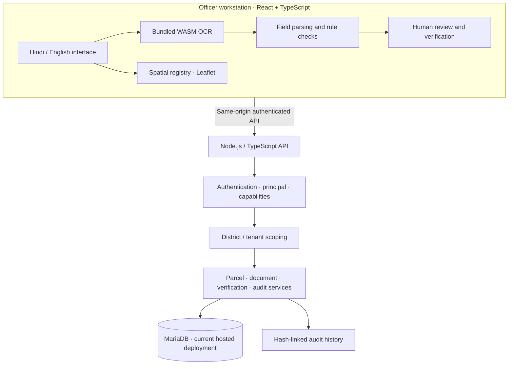

# DHAROHAR — Architecture Overview

## Logical architecture



## Frontend

The browser application provides the bilingual officer interface, document intake, local OCR, structured extraction, validation, map-based parcel workflows, review screens, reports and audit views.

OCR assets are bundled for local execution. The application should make server unavailability explicit and must not present sample fallback records as live database records.

## Backend

The Node.js API is mounted under `/api`. Its request path includes security headers, origin controls, authentication, server-side principal resolution, capability checks, write-role checks and district/tenant scoping.

The backend owns the access decision. A client-supplied role label or district parameter must not widen the authenticated principal's grants.

## Persistence

**Current hosted deployment:** MariaDB 10.11 / MySQL-compatible driver.

**Additional engineering path:** PostgreSQL + PostGIS. This is not the active hosted database and should not be represented as the deployed store.

The logical data model includes organisations, districts, units, users, jurisdiction grants, capabilities, parcels, ownership shares, mutations, field inspections, documents, migrations and append-only audit records.

## Trust boundaries

| Boundary | Expected rule |
|---|---|
| Browser to API | Authenticated requests; validate every input server-side |
| OCR to structured fields | OCR output remains a candidate until reviewed |
| User to district data | Use server-resolved jurisdiction grants |
| Application to database | Parameterised queries and scoped service operations |
| Audit writer to audit history | Consequential actions are linked into the audit chain |
| Demo to real operations | Synthetic demonstration data only; no authoritative claims |

## Deployment topology

```
Public browser
     |
     v
dharohar.urbantechx.in
     |
     +-- Static frontend files (cPanel document root)
     |
     +-- /api -> Node.js application (LiteSpeed / Passenger)
                      |
                      v
                MariaDB database
```

The frontend and backend are deployed separately. A GitHub documentation update does not itself deploy the hosted application. The current deployment procedure uses verified build artefacts and cPanel File Manager / Node.js application controls.

## Operational note

The hosting environment has exhibited intermittent high first-byte latency and connection failures. Client-side health-probe retry and map-layer memoization changes were recorded as pending frontend deployment at the 2026-11-07 checkpoint. Verify the live bundle before claiming those improvements are deployed.
