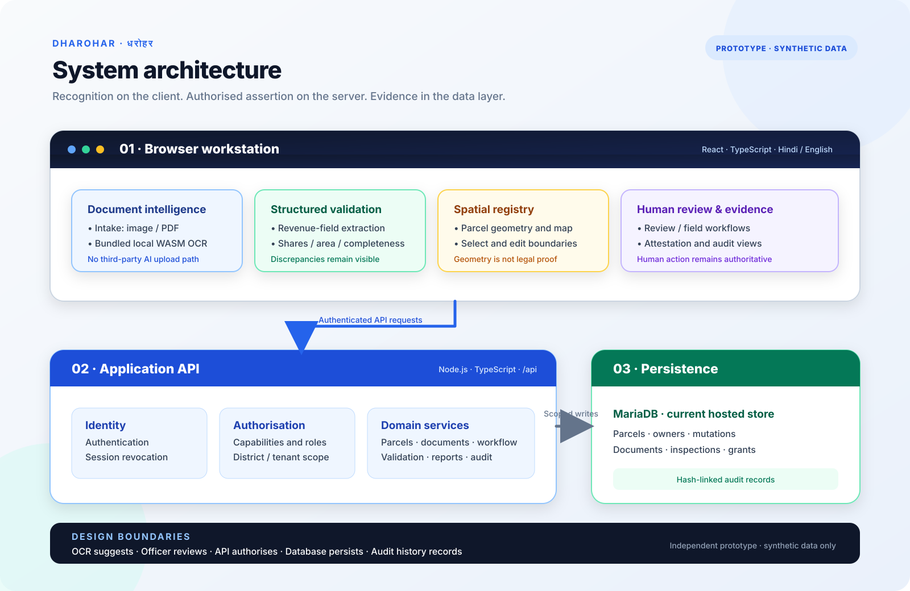
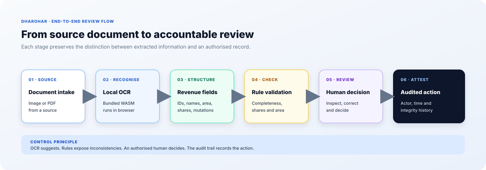

# DHAROHAR · धरोहर
## Land Record Digitisation & Verification Portal

  
  &nbsp;
  
  &nbsp;
  

  <strong>Try the deployed application:</strong>
  <a href="https://dharohar.urbantechx.in">Launch DHAROHAR ↗</a>
  &nbsp;·&nbsp;
  <a href="./DEMONSTRATION_GUIDE.md">Reviewer walkthrough</a>
  &nbsp;·&nbsp;
  <a href="./ARCHITECTURE_OVERVIEW.md">Architecture</a>

**Project status:** deployed prototype on synthetic demonstration data · Hindi and English

DHAROHAR is a revenue-officer workstation for digitising, checking and reviewing land-record information. It brings together browser-based OCR, structured revenue fields, arithmetic validation, parcel geometry, document workflows, human review and an auditable history.

> **Important:** DHAROHAR is an independent prototype using synthetic demonstration data. It is not an official government land-record system, does not establish legal ownership, and is not connected to an authoritative state land-records database.

## Judge demo access

**Live application:** https://dharohar.urbantechx.in

No dedicated public judge account has been verified yet. Credentials will be published here only after a separate account is provisioned and tested to be restricted to synthetic demonstration data, with no administrator or operational privileges.

Until that verification is complete, request evaluation access from the project maintainer. Do not use credentials from other projects or shared internal/demo accounts. See the [Demonstration Guide](./DEMONSTRATION_GUIDE.md) for the walkthrough and access boundaries.

| Demo role | Username | Password | Access |
|---|---|---|---|
| Judge / reviewer | **Pending dedicated account provisioning** | **Will be published after verification** | Restricted synthetic-data demonstration |

**Never publish production administrator credentials, database passwords, JWT signing secrets, private API keys or credentials reused by another project.** The demo is shared infrastructure; use synthetic values only. Do not enter real citizen, officer, identity or land-record data. Please do not perform load tests or authentication-rate testing.

> **Support DHAROHAR:** If you find this project useful, [give the public project repository a star](https://github.com/naamanjain/dharohar). It helps others discover the project and supports the documentation and evaluation work.

## The problem

A parcel's information can be spread across paper records and separate spatial and mutation registers. Officers may need to transcribe and reconcile the same information repeatedly, while citizens face delays when records disagree. Scanning alone preserves an image but does not make its contents reliably searchable or comparable.

Read the [problem statement](./PROBLEM_STATEMENT.md).

## The approach

DHAROHAR separates recognition from assertion:

1. Ingest a document image or PDF.
2. Run bundled OCR locally in the browser.
3. Parse recognised content into structured revenue fields.
4. Check share arithmetic, area values and required fields.
5. Compare parcel information with available spatial and mutation data.
6. Present discrepancies for human review.
7. Record authorised actions in an audit trail.

OCR output is a draft for review, not a legal determination. Officers must verify and approve information before it is treated as an application record.

Read the [solution overview](./SOLUTION_OVERVIEW.md).

## Main capabilities

- Hindi/English officer interface.
- Browser-based OCR using bundled WebAssembly assets.
- Structured parcel, ownership-share and document records.
- Arithmetic and completeness validation.
- Parcel registry with editable boundary geometry.
- District-scoped access and capability-based authorisation.
- Document management and verification workflows.
- Dashboard, metrics and audit-trail views.
- Server-side sign-in challenge and session revocation.

See the [feature matrix](./FEATURES.md) for implementation status and evidence.

## Architecture

The implementation source is maintained separately in a private development repository. This public repository is intentionally documentation-only; it does not contain the application source code.

Explore the [architecture overview](./ARCHITECTURE_OVERVIEW.md) and [design differentiators](./INNOVATION.md).

## Verification snapshot

The following results are from the project's dated live and automated checks. They are not a claim of government certification or production readiness.

| Area | Recorded evidence |
|---|---|
| Authentication challenge | Server-issued challenge, wrong-answer rejection, expiry and replay rejection verified against the deployed API (2026-11-05) |
| Session revocation | Logout invalidates the issued token on subsequent read and write requests |
| Authorisation | Capability checks and district scoping verified; out-of-scope parcel lookup returns 404 |
| Database | Read-only MariaDB checks confirmed migration state, document codes, session revocation and audit-chain integrity (2026-11-05) |
| Audit integrity | Seven entries checked; no null hashes or broken links in that recorded check |
| Map boundaries | Backend parcel response includes boundary geometry; polygon selection/edit handles were verified live (2026-11-07) |
| Automated tests | Recorded passing suites include TypeScript, crypto, CAPTCHA, DTO, tile, i18n, OCR, phase4 and E2E checks; exact dated results and unexecuted gates are documented in [Validation & Evidence](./VALIDATION_AND_EVIDENCE.md) |

## Product evidence

The architecture and workflow diagrams above are included as vector assets. Product screenshots have **not yet been added**; the [Screenshot Evidence Pack](./assets/screenshots/README.md) lists the genuine live-interface captures still required. No generated mock screenshots are presented as proof of a live feature.

## Limitations and roadmap

- No consented real district data has been loaded; semantic reconciliation against actual jamabandi/khasra formats across districts remains future work.
- A seeded synthetic parcel has a known discrepancy between its polygon-derived area and stored mapped-area value; it remains flagged rather than silently altered.
- A second restricted officer identity is needed to complete the separate cross-role comparison.
- Recorded automated OCR tests do not establish accuracy on real district documents.
- The hosting provider has shown intermittent high first-byte latency and connection failures. Client-side resilience and map-layer performance changes were still awaiting frontend deployment at the 2026-11-07 checkpoint; verify the current live build before treating them as deployed.
- The prototype has not been reconciled with authoritative government land records and must not be used to make legal or ownership decisions.

See [Limitations and Future Scope](./LIMITATIONS_AND_FUTURE_SCOPE.md).

## Documentation

| Document | Purpose |
|---|---|
| [Project Overview](./PROJECT_OVERVIEW.md) | Purpose, users, operating boundaries and current status |
| [Problem Statement](./PROBLEM_STATEMENT.md) | Problem context and risks the design avoids |
| [Solution Overview](./SOLUTION_OVERVIEW.md) | End-to-end workflow and product principles |
| [Architecture Overview](./ARCHITECTURE_OVERVIEW.md) | Frontend, API, persistence and trust boundaries |
| [Design and Innovation](./INNOVATION.md) | Specific design differentiators and what the prototype does not claim |
| [Feature Matrix](./FEATURES.md) | Implemented capabilities and evidence status |
| [Validation and Evidence](./VALIDATION_AND_EVIDENCE.md) | Dated automated, browser, API and database results |
| [Limitations and Future Scope](./LIMITATIONS_AND_FUTURE_SCOPE.md) | Known gaps and responsible next steps |
| [Demonstration Guide](./DEMONSTRATION_GUIDE.md) | Judge access and suggested product walkthrough |
| [Rights Notice](./RIGHTS_NOTICE.md) | Project materials and third-party notices |
| [Full Evaluation Package](./EVALUATION_PACKAGE.md) | Consolidated evaluation narrative |

## Rights and third-party notices

DHAROHAR's implementation source is not published in this repository. Project documentation and original project materials are reserved by the project author unless stated otherwise. Third-party libraries, OCR assets, map services and datasets remain subject to their respective licences and attribution requirements. See the [Rights Notice](./RIGHTS_NOTICE.md).
