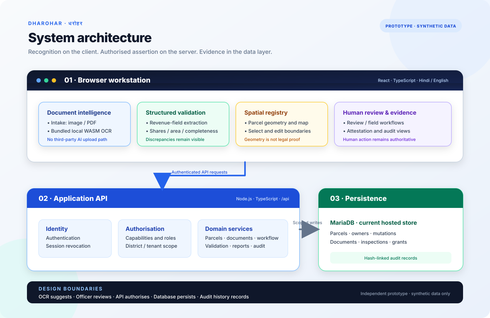
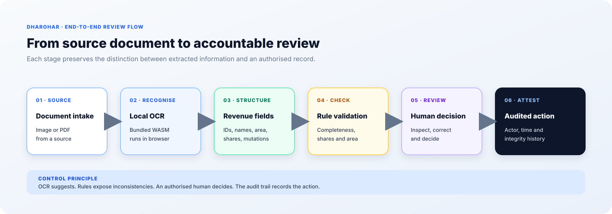

# DHAROHAR — Evaluation Package

**A bilingual land-record digitisation and verification workstation prototype.**

  <a href="https://dharohar.urbantechx.in">Open Live Demonstration</a> ·
  <a href="../README.md">Project README</a> ·
  <a href="DEMONSTRATION_GUIDE.md">Judge Walkthrough</a>

| Item | Description |
|---|---|
| Public project repository | https://github.com/naamanjain/dharohar |
| Live demonstration | https://dharohar.urbantechx.in |
| Interface | Hindi and English |
| Hosted application | Static frontend + Node.js API under `/api` |
| Current database | MariaDB on the hosted cPanel deployment |
| Data status | Synthetic demonstration records only |
| Source code | Maintained separately in a private development repository |
| Evaluation status | Working prototype; not an authoritative land-record system |

## Executive summary

DHAROHAR is designed to help revenue officers organise and review land-record information that may be distributed across paper registers, scanned documents, mutation histories and spatial records.

The workstation combines local browser-based OCR, structured revenue fields, arithmetic and completeness checks, parcel geometry, document management, human review and an auditable history. Its central design principle is that **recognition is not assertion**: extracted data is a candidate for review, not an automatic legal determination.

The hosted demonstration is a prototype on synthetic data. It is not an official government service, does not establish legal ownership and is not connected to an authoritative state land-record registry.

## 1. Problem statement

A parcel's information can be distributed across multiple documentary and spatial sources. Identifiers, area, ownership shares, mutation history and mapped boundaries may be held in different registers or formats.

Scanning preserves an image but does not, by itself, create reliable structured information. Manual transcription can introduce mistakes; OCR can misread handwriting, abbreviations, names, fractions and units. A system that silently accepts extracted text can turn a recognition error into an operational record.

An officer-facing tool should make source information easier to capture, compare and review, while preserving provenance, jurisdiction boundaries and human accountability.

See [Problem Statement](PROBLEM_STATEMENT.md).

## 2. Proposed solution

DHAROHAR separates recognition and assertion into stages:

1. Document image or PDF intake.
2. Browser-based OCR using bundled assets.
3. Parsing into revenue-oriented fields such as khasra, khata, khewat, village, tehsil, area, owner and share information.
4. Completeness and arithmetic validation.
5. Connection to parcel and spatial context where available.
6. Human review and correction.
7. Authorised verification actions and audit history.

OCR output is not treated as proof of ownership. A polygon is not treated as a legally certified boundary. Missing information is surfaced rather than invented.

See [Solution Overview](SOLUTION_OVERVIEW.md).

## 3. Product principles

| Principle | Implementation intent |
|---|---|
| Human review remains authoritative | OCR and rule output support a reviewer; they do not make legal decisions |
| Explainable checks | Discrepancies should identify the values being compared |
| Explicit authority | Role, capabilities and jurisdiction are resolved on the server |
| District isolation | A client-supplied district parameter cannot widen server-side grants |
| Honest data status | Offline/sample fallback must not be presented as live database data |
| Auditability | Consequential actions are represented in a hash-linked history |
| Privacy-aware processing | OCR runs in the browser using bundled assets rather than a third-party AI transcription endpoint |

## 4. System architecture

The current hosted deployment uses MariaDB. PostgreSQL/PostGIS is an additional engineering path and is not the active hosted database.

See [Architecture Overview](ARCHITECTURE_OVERVIEW.md) and [Design and Innovation](INNOVATION.md).

## 5. Main modules

| Module | Purpose |
|---|---|
| Authentication and session | Officer sign-in, server-issued challenge and session lifecycle |
| Digitisation | Document intake and browser-based OCR |
| Extraction | Candidate revenue-field parsing |
| Quality and validation | Completeness, share and area checks |
| Parcel registry | Parcel identifiers, location and geometry |
| Spatial registry | Map context and boundary interaction |
| Document management | Document records, metadata and parcel links |
| Human verification | Officer review and workflow transitions |
| Field verification | On-ground observation workflow |
| Dashboard and reports | Available metrics and operational summaries |
| Administration | Officers, capabilities and jurisdiction grants |
| Audit trail | Hash-linked history of consequential actions |

The [Feature Matrix](FEATURES.md) distinguishes tested, partial, pending-deployment and unverified capabilities.

## 6. Technology stack

| Layer | Technology |
|---|---|
| Frontend | React, TypeScript, Vite |
| UI and mapping | Tailwind-based interface, Leaflet |
| OCR | Bundled browser-side WebAssembly OCR assets |
| Backend | Node.js and TypeScript |
| Current hosted database | MariaDB / MySQL-compatible driver |
| Additional database path | PostgreSQL + PostGIS |
| Hosting | cPanel, LiteSpeed / Passenger |
| Authentication | Server-side principal, capability and jurisdiction checks |
| Integrity | Hash-linked audit records |

## 7. Data model overview

The conceptual data model includes:

- Organisations, districts and administrative units.
- Users, explicit jurisdiction grants and discrete capability grants.
- Parcels and parcel ownership shares.
- Mutation history.
- Field inspections.
- Source documents and extracted information.
- Schema migration records.
- Append-only, hash-linked audit records.

The public evaluation repository intentionally documents the model rather than publishing SQL dumps or implementation files.

## 8. API overview

The hosted API is mounted under `/api`. Its main areas include:

| Area | Example route family | Purpose |
|---|---|---|
| Health | `/api/health` | Runtime status |
| Authentication | `/api/auth/*` | Login, current principal and logout |
| Parcels | `/api/parcels/*` | Parcel registry and lifecycle |
| Documents | `/api/documents/*` | Document retrieval and linking |
| Verifications | `/api/verifications/*` | Human and field verification |
| Districts | `/api/districts` | District registry |
| Administration | `/api/admin/*` | Restricted officer administration |
| Audit | `/api/audit/*` | Audit-chain inspection |

Protected routes require authentication and applicable role, capability and jurisdiction checks. This table is an overview, not a substitute for the private implementation's route contract.

## 9. Validation and evidence

### Live checks recorded 2026-11-05

The project completion report recorded 30/30 live checks for the deployed CAPTCHA, session and document-code behaviour. The checks included missing, incorrect, expired and replayed challenge rejection; successful login; logout revocation; and fresh login after logout.

Read-only MariaDB checks recorded:
- schema migrations 0001–0003, including session revocation;
- persisted session revocation;
- district-scoped parcel records;
- populated document codes on five documents;
- a seven-row audit chain with no null hashes or broken links at that check.

### Live checks recorded 2026-11-07

The follow-up map/performance investigation recorded:
- parcel boundary geometry returned by the backend;
- a five-vertex polygon rendered and selectable in the browser;
- five draggable boundary-edit handles;
- granted parcel read returning 200 and out-of-scope parcel read returning 404;
- logout followed by `401 SESSION_REVOKED` on read and write paths;
- an audit chain with 12 entries at that later check;
- a CAPTCHA state matrix including correct, wrong, missing, replayed and expired challenge cases.

The recorded live suite result was 27/28. The single failure was attributed to a harness query for a district not granted to the signed-in officer; it was not treated as a product defect.

### Automated evidence recorded 2026-11-07

The report recorded clean TypeScript compilation and production build, with passing cryptography, CAPTCHA, DTO, tile-provider, health-probe, i18n, OCR, phase4 and E2E suites.

The same report recorded MySQL integration, stack validation and Docker gates as **NOT EXECUTED** in that environment. They are not represented as passing.

Full dated detail: [Validation and Evidence](VALIDATION_AND_EVIDENCE.md).

## 10. Security and privacy boundaries

- Production credentials, database passwords, JWT signing secrets and private API keys do not belong in this repository.
- Judge access must use a dedicated, restricted account rather than an administrator or operational identity.
- Public demonstration data must remain synthetic.
- Access control must be enforced by the server, not trusted from client-supplied role or district fields.
- Sensitive findings should be reported privately rather than posted with exploitable detail in public issues.
- No real citizen or officer data should be entered into the demonstration.

## 11. Current limitations

1. The prototype is not connected to authoritative government land records.
2. OCR accuracy across real district document formats has not been established.
3. A seeded synthetic parcel was reported with a polygon-derived area of 38.061 ha and a stored mapped area of 1.29 ha; the discrepancy remains flagged rather than silently modified.
4. A second restricted officer identity is needed for separate cross-role and multi-account testing.
5. The hosting provider has exhibited intermittent high first-byte latency and connection failures.
6. At the 2026-11-07 checkpoint, frontend health-probe resilience and polygon-layer memoization changes were recorded as not yet deployed.
7. MySQL integration, stack validation and Docker gates were recorded as not executed in the latest supplied environment.

See [Limitations and Future Scope](LIMITATIONS_AND_FUTURE_SCOPE.md).

## 12. Demonstration access

**Live URL:** https://dharohar.urbantechx.in

Dedicated judge credentials are being provisioned separately from administrator and operational identities. They should be published only after the account is restricted to synthetic records and verified not to carry administrative or operational write privileges.

See [Demonstration Guide](DEMONSTRATION_GUIDE.md). No production or shared internal credentials are included in this package.

## 13. Public repository contents

This repository is intentionally documentation-only.

| Document | Contents |
|---|---|
| [Project Overview](PROJECT_OVERVIEW.md) | Project summary and audience |
| [Problem Statement](PROBLEM_STATEMENT.md) | Problem context and design risks |
| [Solution Overview](SOLUTION_OVERVIEW.md) | Workflow and operating principles |
| [Architecture Overview](ARCHITECTURE_OVERVIEW.md) | Components and trust boundaries |
| [Design and Innovation](INNOVATION.md) | Design differentiators and explicit non-claims |
| [Screenshot Evidence Pack](../assets/screenshots/README.md) | Genuine UI captures to be added after live verification |
| [Features](FEATURES.md) | Feature status matrix |
| [Validation and Evidence](VALIDATION_AND_EVIDENCE.md) | Dated verification evidence |
| [Limitations and Future Scope](LIMITATIONS_AND_FUTURE_SCOPE.md) | Known constraints and roadmap |
| [Demonstration Guide](DEMONSTRATION_GUIDE.md) | Reviewer journey and access boundaries |
| [Rights Notice](RIGHTS_NOTICE.md) | Ownership and third-party terms |

The private development repository contains the implementation. This public repository does not include application source code, environment files, secrets, database dumps, release archives or build output.

## 14. Responsible-use statement

DHAROHAR is a prototype for project evaluation and technical demonstration. It is not an authoritative land-record system, does not determine ownership and must not be used for legal, administrative or financial decisions. Any future real-data pilot would require the relevant authority's approval, an authorised data agreement, privacy and security assessment, representative validation, tested operational controls and accountable human review.
